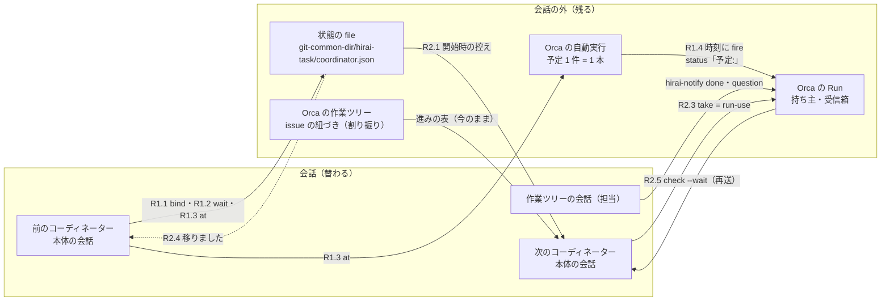

# コーディネーターを引き継げる役割にする（状態を会話の外に・本体の差分の見張り・要る版の宣言）（4.2.0）

id_prefix: TKC
kind: ハーネス・進め方
domain: —
implements: bin/hirai-task（新しい subcommand `coord`）, hooks/session-start.sh, hooks/coordinator-load.sh, hooks/loop-reminder.sh, hooks/hooks.json, scripts/tasks-path.sh, scripts/statusline.sh
decisions: heyapro-app #2112（テックリード 2026-11-27 の会話）・heyapro-app ADR-0833〜0836（同じ設計の heyapro-app の PR で起案）
upstream: docs/draft/tkm-harness.md（TKM-R9 進みの表とコーディネーターの判定）・docs/draft/tkm-harness-settings.md（TKS-R1 効く順）
downstream: heyapro-app の `.claude/skills/delegation/SKILL.md`・`.claude/settings.json`・`docs/harness/plugin-and-harness.md`（§7 の T6）
supersedes: —
wave: —
status: 起案
approvals: 要件=heyapro-app #2112 設計=この PR task=この PR
approved_at:
merged_into:

起案: 2026-11-27（heyapro-app #2112 の作業ツリー 2112-coordinator-role-design）。実測は同じ日の 19:05〜19:25（Orca 1.4.229・macOS 26.0・tkm-harness 4.1.0）。

## 1. 目的

### 提案: コーディネーターの状態を会話の外に置いてどの会話でも引き継げるようにし、本体の checkout の差分と、リポが要るプラグインの版を、止めずに知らせる

**決めること**: コーディネーターの状態（束ねる Run・答え待ち・時刻の予定）を本体の git の共有の置き場の 1 file と Orca（Run・自動実行）に置き、新しい会話が `hirai-task coord take` で引き継ぐ形と、本体の差分・要る版を hook で知らせる形を採るか。**推奨**: 承認する

**目的**: 会話を替えても、割り振り・答え待ち・時刻の予定・担当からの知らせが失われず、次の会話がそのまま続けられる。本体に git に入る差分ができたことと、プラグインの版が足りないことに、その会話がその場で気づける

**位置**: ハーネスの改善。tkm-harness 4.2.0（§7 の T1〜T5）と heyapro-app（T6）の 2 本の PR

**承認すると**: 実装の task 6 本（§7）。どれも戻せる（状態の file は消せば元どおり・hook は文を出すだけで止めない・要る版は settings の 1 行）

**しないと**:
- 2026-11-27 に、会話の中だけにあった予行の予約（CronCreate）と知らせの受け口が、会話の切り替えと再起動で 2 回消えた（heyapro-app #2112 の本文）
- 本体の checkout に、19:05 の時点で git に入る差分が 2 件あった（` M .mcp.json`・`?? qqqq`。§2 の M3-1）。Edit・Write は止まるが Bash の書き換えは止まらず、誰にも知らされない（F6）
- 版の上げは「プラグインを入れてから merge する」順を人が守る（heyapro-app `docs/harness/plugin-and-harness.md` §4.1）。開いたままの会話は開き直すまで古い版で、黙って動く

**注意**: 時刻の予定は、Orca の自動実行の precheck（エージェントを起こす前に回すコマンド）だけを使い、エージェントは起こさない（M1-3）。Orca の版が上がって precheck の cwd や環境が変わると予定が届かなくなるので、実装の task で selftest と開始時の 1 行で気づけるようにする（TKC-R1.5）

## 決まったこと（テックリード 2026-11-27・原文は heyapro-app #2112）

- 役割は 3 つ。コーディネーター（テックリードとの窓口・issue への書き込み・merge・stg に触る順番）／作業ツリーの会話（成果物を作り、レビュー・CI・承認の門を通す）／調べの担当（subagent・Workflow。大量に読んで短い答えを返す）
- 成果物 = 案件の文書とコード = repo に入るもの。MDV などの資料は成果物ではない
- task をやるのは作業ツリー。それ以外の仕事はコーディネーター。コーディネーターは成果物を作れない。読む量の多い調べは subagent か Workflow に出す
- コーディネーターの状態（割り振り・答え待ち・時刻の予定・知らせの受け口）を会話の外に置き、どの会話でも引き継げるようにする
- プラグインで直すものは 3 つ: (1) コーディネーターの引き継ぎ (2) 本体の checkout に git に入る file の差分ができたら知らせる（止めない）(3) repo が要る版を宣言し、足りない会話に直し方を出す
- 手元の検査（ci:local）の回し方は、今回は直さない（原文「4はふよう」）
- 原文: 「プラグインを直しましょう」「タスクをやる場合は作業ツリー それ以外の仕事はコーディネータ コーディネータは成果物を作れない」「ちゃんと設計したいです」「1,2,3は問題ないです。4はふよう開始して下さい。」

## 2. 事実（出どころつき）

### 2-1. 今の作り（4.1.0。プラグインの file は読んだだけ）

| # | 事柄 | 出どころ |
|---|---|---|
| F1 | hook の script は 6 本で、数の予算の上限 6 に達している。smoke の case も 10 で上限 10 | `tests/smoke.sh:2663-2673`（case 6）・`ls hooks/*.sh` = 6 本・`grep -c '^case_[0-9]*()' tests/smoke.sh` = 10 |
| F2 | hirai-task は本体と全部の作業ツリーで共有する状態を `<git-common-dir>/hirai-task/` に置く。割り振りの控え `load-assign.json`・前に出した表 `load-last.json`・役割の控え（端末ごと・600 秒） | `bin/hirai-task:731-737`・`:5810-5811`・`:6241` |
| F3 | コーディネーターの判定は「親がいるか」: `TKM_HARNESS_ROLE` > `HC_NOTIFY=off` > Orca が無い > `worker-list` に端末が載っているか | `bin/hirai-task:6312-6332` |
| F4 | 担当の宛先の控えは作業ツリーごとの `.claude/state/coordinator`（1 行 `run:<id>`・24 時間で失効）。開始時の「前回の続き」は `coordinator` で始まる file を外す | `bin/hirai-notify:153-165`・`hooks/session-start.sh:129` |
| F5 | コーディネーターの会話にだけ、開始時に進みの表を additionalContext で入れ、振り出し・完了の Bash のあとに表を systemMessage と additionalContext で出す | `hooks/session-start.sh:178-239`・`hooks/coordinator-load.sh:1-53` |
| F6 | `worktree: block` が止めるのは、Orca の作業ツリーの外の会話からの Edit・Write・NotebookEdit と `git commit` だけ。Bash はコマンドに `commit` の字があるときだけ見て、それ以外は通す（Bash での file の書き換えは止まらない） | `hooks/worktree-guard.sh:1-27`・`:543`・heyapro-app `docs/rules-reference/ops-stop-forms.md:19` |
| F7 | 更新の合図は「配布元の main の版 > 動いている版」のときだけ出し、リポが要る版は見ない | `scripts/update-check.sh:195-204` |
| F8 | 時刻の予定（CronCreate）と知らせの受け口（`check --wait` の待ち）は会話の中にあり、会話が替わると消える。11-27 に 2 回 | heyapro-app #2112 の本文 |

### 2-2. Orca の口（`orca --help`・`orca skills get orchestration`。1.4.229）

| # | 事柄 | 出どころ |
|---|---|---|
| F9 | Run は「durable namespace and coordinator inbox」。`send` が成功すれば受信箱に入ったことまでは保証し、相手が読んだかは保証しない | `orca skills get orchestration` の「Authority and safety floor」 |
| F10 | `orchestration run-use --id <run>` は「Bind this coordinator to an existing Run」。`check` は束ねた Run の一番古い束を受領（`--ack`）まで繰り返し返す | `orca orchestration run-use --help`・`orca orchestration check --help` |
| F11 | `automations create` は preset・5 欄の cron・RRULE の時刻で動き、`--precheck` のコマンドが exit 0 のときだけエージェントを起こし、それ以外は「skipped run」と記録する | `orca automations create --help` |

### 2-3. 実測（使い捨ての Run・端末・自動実行・launchd の job。本体は `GIT_OPTIONAL_LOCKS=0` の読み取りだけ・STG は触らない）

| # | 試したこと | 結果 |
|---|---|---|
| M1-1 | 自動実行を毎分（`* * * * *`・Asia/Tokyo）・precheck つきで作る | 作れた。返りは `schedulerOwner: local_host_service`・`missedRunPolicy: run_once_within_grace`・`missedRunGraceMinutes: 720` |
| M1-2 | precheck が動く時刻 | 毎分、予定の分の 16 秒後（19:08:16〜19:13:16 の 6 回） |
| M1-3 | precheck が exit 1 | 履歴は `status: skipped_precheck`・`agentSessionId: null`。エージェントは起きない |
| M1-4 | precheck の cwd と環境 | cwd は本体の checkout（workspace に作業ツリーを渡しても）。Orca の環境変数は `ORCA_APP_VERSION`・`ORCA_USER_DATA_PATH` だけで、`ORCA_TERMINAL_HANDLE` が無い |
| M1-5 | precheck から `orchestration send --to run:<id>`（`--from` なし） | 断られる（`no_active_sender_terminal`） |
| M1-6 | `--from <Run の持ち主の端末>` を付ける（`run-show` で引く） | 通る |
| M1-7 | 持ち主の端末を閉じたあと、同じ `--from` | 通る（2 回） |
| M1-8 | precheck の中から `automations remove <自分の id>` | 通る。一覧も履歴も 0 件 |
| M1-9 | launchd（`launchctl bootstrap gui/<uid>`・StartCalendarInterval） | 予定の分の 4 秒後に動いた。PATH に orca が無い（絶対 path で呼んだ）。`--from` つきで送れた |
| M2-1 | 担当の端末から別の Run へ send | 断られる（`dispatch_run_mismatch`） |
| M2-2 | 端末 A が Run を作り、端末 S が送ったあと、A が生きたまま端末 B で `run-use` | 通る（断られない）。持ち主が B に移り、A の `check` は空（エラーは出ない） |
| M2-3 | B を受領せずに閉じ、端末 C で `run-use` → `check` | 交代の前の知らせが C に届く |
| M2-4 | C が受領しないまま、自動実行が 5 通・launchd が 1 通送り（うち 2 通は C を閉じて持ち主の会話がいない間）、端末 D で `run-use` → `check` | 交代の前の 1 通と合わせて 7 通が 1 つの束で D に届いた。`--ack` のあとは空 |
| M2-5 | 束ねていない端末から `check --run <id>` | 断られる（`consumer_fenced`） |
| M2-6 | 束ねていない端末から `check --terminal <閉じた持ち主の handle>` | 読めて `--ack` も通る。持ち主の記録は変わらない |
| M2-7 | heyapro-app の今の Run `run_a0b800705b2e` を `run-show` | 持ち主の記録は 11-22 の端末のまま（`consumer_generation: 1`）で、その端末は `terminal list` に無い。今のコーディネーターの端末は持ち主ではない |
| M3-1 | 本体（5,799 file・fsmonitor なし）で `git status --porcelain` | 中央値 37 ms（7 回）・2 行 |
| M3-2 | 作業ツリーから本体を引いて同じものを見る（`git rev-parse --git-common-dir` ＋ status） | 中央値 55 ms |
| M3-3 | `orca orchestration run-show --json` | 中央値 136 ms |

M2-7 から、今のコーディネーターは前の持ち主の handle を名乗って受信箱を読んでいる、と推測する（M2-6 の形。打っているコマンドは見ていない）。

## 3. 要件（〜のとき〜する｜確かめ）

### 要件 TKC-R1: コーディネーターの状態を会話の外に置く

状態の file は `<git-common-dir>/hirai-task/coordinator.json`（F2 と同じ置き場）。書くのは `hirai-task coord` だけ。割り振りは書かない（Orca の作業ツリーの issue と `load-assign.json` のまま。2 か所と食い違わないため）。

| ID | 〜のとき、〜する | 確かめ |
|---|---|---|
| TKC-R1.1 | コーディネーターが Run を作るか束ねたとき、`hirai-task coord bind [<run>]`（引数が無ければ `run-current`）が Run の id・持ち主の端末・時刻を書く | selftest（偽の orca）で file の run と owner を見る |
| TKC-R1.2 | テックリードに承認・判断を頼んだとき、`coord wait add <文> [--ref <PR か issue>]` が答え待ちを 1 件足し、答えを受けたら `coord wait done <id>` が消す | selftest |
| TKC-R1.3 | 時刻の予定を持つとき、`coord at "<YYYY-MM-DD HH:MM>" <文>` が Orca の自動実行を 1 本作り（その分の cron・`--timezone`・`--workspace` は本体・precheck は `coord fire <id>; exit 1`）、予定を書く。CronCreate は使わない | 使い捨ての Run で 2 分後の予定 → 受信箱に「予定: 〜」が届き、自動実行が消える |
| TKC-R1.4 | 予定の時刻に、`coord fire <id>` が file の Run の持ち主を `--from` にして `run:<id>` へ `--type status --subject "予定: <文>"` を送り、予定を「送った」にして自分の自動実行を消す。終わりは必ず exit 0 以外（エージェントを起こさない） | M1-3・M1-6・M1-8 と同じ形を selftest（偽の orca） |
| TKC-R1.5 | Run が無い・送れないとき、`fire` は予定を「届かず」にし、次の会話の開始時に「過ぎた予定」として出す。precheck の cwd が本体でない・`orca` が見つからないときも「届かず」にする（Orca の変わりに気づく） | selftest（Run なし・orca なし） |
| TKC-R1.6 | 2 つの会話が同時に書くとき、lock と原子的な書き込みで片方を失わない（`_write_assignments` と同じ形） | selftest（2 本同時の `wait add`） |
| TKC-R1.7 | `coord show [--json]` が Run・持ち主がこの会話か・答え待ち・予定・本体の差分の件数を出す。GitHub を叩かない | selftest |
| TKC-R1.8 | プラグインの版が上がっても予定が動く。precheck は版の dir を決め打ちせず、`installed_plugins.json` の最大版の hirai-task を引く（`harness_plugin_root_from_installed` と同じ） | selftest（版の dir を 2 つ置く） |

### 要件 TKC-R2: どの会話でも引き継げる

| ID | 〜のとき、〜する | 確かめ |
|---|---|---|
| TKC-R2.1 | コーディネーターの会話（F3）の開始・`/clear`・圧縮のあとに状態の file があれば、「コーディネーターの控え」（Run・持ち主がこの会話か・答え待ち・次の予定 3 件・過ぎた予定・本体の差分の件数）を進みの表の前に additionalContext で入れる（10,000 字の内） | smoke（偽の file と偽の orca） |
| TKC-R2.2 | 持ち主がこの会話の端末でないとき、控えの頭に「引き継ぐなら `hirai-task coord take`。受け口は `orca orchestration check --wait …` を背景で回す」を出す | smoke |
| TKC-R2.3 | `coord take` が `orca orchestration run-use --id <run>` を打ち、新しい持ち主と時刻を書き、受け口のコマンドを 1 行で出す。前の持ち主の端末が生きていても断らず、そのことを 1 行で言う（M2-2。Orca も断らない） | 使い捨ての Run で 2 つの端末・selftest（偽の orca） |
| TKC-R2.4 | 前の持ち主の会話が、次の Bash のあと（PostToolUse）か発言のとき（UserPromptSubmit）に、file の持ち主が自分の端末でないと知ったら、1 回だけ「コーディネーターは別の会話（<端末>）に移りました。issue・merge・受け口をやめる」と出す。file を読むだけで orca は呼ばない | smoke |
| TKC-R2.5 | 受け口は会話の中で回す（hook は会話に背景の待ちを起こせない）。引き継いだ会話は束ね直してから回し、再送された束を全部さばいてから `--ack` する（M2-3・M2-4） | 手順（SKILL の文）と R2.2 の 1 行 |
| TKC-R2.6 | 他人の handle を名乗って受信箱を読む形（M2-6）は手順に書かず、束ね直しは `run-use` だけにする | 文の検査（README と SKILL に `check --terminal <前の持ち主>` が無い） |

### 要件 TKC-R3: 本体の checkout の差分を、止めずに知らせる

| ID | 〜のとき、〜する | 確かめ |
|---|---|---|
| TKC-R3.1 | `TKM_HARNESS_WORKTREE=block` のリポの、本体の checkout の会話で、Bash のあと（PostToolUse）・発言のとき（UserPromptSubmit）・開始時に、`GIT_OPTIONAL_LOCKS=0 git -C <本体> status --porcelain --untracked-files=normal` の行（`.tmp/`・`.claude/state/` を除く）を見る | smoke（使い捨てのリポに 1 file 足す） |
| TKC-R3.2 | 作業ツリーの会話は、Bash のコマンドの文に本体の path があるときだけ同じものを見る。それ以外は git を打たない | smoke（path を含む・含まない） |
| TKC-R3.3 | 行の組がその会話に前に知らせた組と違い、空でないとき、systemMessage（人の画面）と additionalContext（AI）に 1 回だけ出す: 本体の path・件数・先頭 5 行・「止めていません。この会話の操作なら戻す。覚えが無ければ人に聞く（本体では編集・commit をしない）」。空に戻ったら控えを消し、次に出たらまた知らせる | smoke（同じ組で 2 回目は出ない・消して足すとまた出る） |
| TKC-R3.4 | 止めない（常に exit 0・permissionDecision を出さない）。1 回の見張りは 200 ms の内（M3-2 は 55 ms）。block でないリポでは git も python も起こさない | smoke（block でないリポで git を呼ばない） |
| TKC-R3.5 | 会話ごとの控えは `${TMPDIR}/claude-harness-lite/main-diff-<session>.sig`（`context-budget.sh` の旗と同じ置き場）。本体の index に書かない | smoke（本体の `.git/index` の mtime が変わらない） |

### 要件 TKC-R4: リポが要る版を宣言し、足りない会話に直し方を出す

| ID | 〜のとき、〜する | 確かめ |
|---|---|---|
| TKC-R4.1 | リポは `.claude/settings.json` の `env` の `TKM_HARNESS_REQUIRES` に、要る tkm-harness の最小の版（`<major>.<minor>.<patch>`）を書く。効く順は TKS-R1.1（mode などと同じ） | selftest（tasks-path.sh の項目） |
| TKC-R4.2 | 会話の開始時に、動いている版（`$CLAUDE_PLUGIN_ROOT/VERSION`）が要る版より低いとき、開始時の行の 4 行目に 1 行出す。入っている版（`installed_plugins.json` の、このリポの本体の checkout の行）が要る版以上なら「入っている <版> で開き直す（`/reload-plugins` か、閉じて `claude --resume`）」、入っている版も低ければ、人が本体で 1 行ずつ打つ `claude plugin marketplace update tkm-harness`・`claude plugin update tkm-harness@tkm-harness --scope project` と「開き直す」 | smoke（版の組 3 通り） |
| TKC-R4.3 | 会話の途中で要る版が上がったとき（settings の file を保存すると env が変わる・TKS F4）、次の発言のとき（UserPromptSubmit）に同じ 1 行を 1 回だけ出す | smoke |
| TKC-R4.4 | 画面下に「版が足りない <動いている版> < <要る版>」を出す | smoke（statusline の出力） |
| TKC-R4.5 | 担当の会話（F3）では、同じ 1 行に「担当はプラグインを入れ替えず、`hirai-notify question` で知らせる」を足す | smoke |
| TKC-R4.6 | 止めない。値の形が違うときは 1 行で言って比べない。要る版が無いリポでは何も出さない。4.1.0 以前の会話はこの値を読まない（4.2.0 から効く） | smoke |

## 4. 構成



| 部品 | 置き場 | 書く | 読む |
|---|---|---|---|
| 状態の file（R1） | `<git-common-dir>/hirai-task/coordinator.json` | `hirai-task coord`（bind・take・wait・at・fire） | `coord show`・開始時の控え（R2.1）・「移りました」（R2.4） |
| Run の受信箱（F9） | Orca | 担当（`hirai-notify`）・予定（`fire`） | 持ち主の会話の受け口（R2.5） |
| 自動実行（R1.3） | Orca（`automations list` でどの会話からも見える） | `coord at`（作る）・`fire`（消す） | Orca |
| 割り振り | Orca の作業ツリーの issue・`load-assign.json`（F2） | 今のまま | 今のまま |
| 本体の差分の控え（R3.5） | `${TMPDIR}/claude-harness-lite/` | hook | hook |
| 要る版（R4.1） | 導入先の `.claude/settings.json` の `env` | 導入先のリポ | hook・画面下 |

状態の file の形（例）:

```json
{
  "version": 1,
  "run": {"id": "run_…", "owner": "term_…", "bound_at": "2026-11-27T19:06:24+09:00"},
  "waits": [{"id": "w1", "what": "PR 2092 の merge の承認", "ref": "heyapro-app#2092", "since": "2026-11-27T18:40:00+09:00"}],
  "schedules": [{"id": "s1", "at": "2026-11-27T21:45:00+09:00", "what": "STG の予行を始める", "automation": "<Orca の id>", "state": "待ち"}]
}
```

hook の数は 6 のまま（F1）。足す先:

| hook | 足すこと |
|---|---|
| `hooks/session-start.sh`（SessionStart） | 控え（R2.1・R2.2）・本体の差分（R3.1）・版（R4.2・R4.5） |
| `hooks/coordinator-load.sh`（PostToolUse・Bash。hooks.json で UserPromptSubmit にも同じ script を載せる。`notify-attention.sh` が 3 つの event に載るのと同じ形） | 移りました（R2.4）・本体の差分（R3.1〜R3.3） |
| `hooks/loop-reminder.sh`（UserPromptSubmit） | 版（R4.3。normal でも足りないときだけ 1 行） |
| `scripts/statusline.sh`（画面下） | 版（R4.4） |

引き継ぎの手順（新しい会話）:

1. 本体で `HC_NOTIFY=off claude` で開く（今のまま。heyapro-app `.claude/skills/delegation/SKILL.md:49`）
2. 開始時の控え（R2.1）を読む
3. `hirai-task coord take`（R2.3）
4. 受け口 `orca orchestration check --wait --types worker_done,escalation,question,status --timeout-ms 900000 --json` を背景で回す
5. 再送された束を全部さばいてから `--ack` する（M2-3）
6. 答え待ちと過ぎた予定をテックリードに 1 回で伝える

## 5. 採らなかった案

- 時刻の予定を CronCreate のままにし、引き継ぎで作り直す: 会話が落ちると消え（F8）、作り直しを忘れても気づく手段が無い
- 時刻の予定を launchd で持つ: 動く（M1-9）が macOS だけで、`orca automations list` に出ず、どの会話からも同じ一覧で引けない。plist を家の dir に置き、消し忘れが残る
- 自動実行でエージェントを起こし、プロンプトで知らせを送らせる: 予定ごとに会話が 1 本立ち、tokens がかかる。precheck だけで送れる（M1-6）
- Claude Code の cloud の routine（`/schedule`）: 手元の Orca の受信箱に届かない（読んだだけ・未測定）
- AI が Markdown の控え（`/tkm-harness:state save` の形）に手で書く: 書き忘れると古くなり、予定を時刻に動かせない
- 本体の `.claude/state/` に置く: 担当の宛先の控え（F4 の `.claude/state/coordinator`）と名前が近く、作業ツリーごとに置き場が分かれる。共有の置き場は hirai-task が既に使う（F2）
- 割り振りも状態の file に書く: Orca の作業ツリーと `load-assign.json` の 2 か所と食い違う
- 前の持ち主の端末が生きていれば `take` を断る: 会話を替えるときは前のタブが残ることが多く、毎回の上書きの指定が要る。Orca も断らない（M2-2）。代わりに前の会話へ「移りました」を出す（R2.4）
- 前の持ち主の handle を名乗って読み続ける（M2-6）: 持ち主の記録が古いまま残り（M2-7）、2 つの会話が同じ受信箱を読める
- 本体の差分を止める: 決まったこと「止めない」。止める仕組みは不可逆の操作だけ（rules/_meta.md 条 5）
- 全部の会話の Bash のあとに本体を見る: 担当の Bash ごとに 55 ms かかる（M3-2）。担当が本体に書くのは、コマンドに本体の path を書いたときだけ（R3.2）
- 発言のときだけ見る: コーディネーター自身の Bash の書き換えに、その場で気づけない
- 版が足りなければ止める: 決まったこと「直し方を出す」。止めると、直すための会話も開けない
- `installed_plugins.json` の版だけを見る: 開いている会話は開き直すまで古い版で動く（heyapro-app `docs/harness/plugin-and-harness.md:108`）。動いている版と入っている版の両方を見る（R4.2）

## 6. 未検証（実装の task で測る）

- Orca を止めた間の予定（M1-1 の `missedRunPolicy`・720 分は create の返りの値だけ。Orca を止めると全部の担当が止まるので試していない）
- `--workspace` に本体の checkout を渡した自動実行（測ったのは作業ツリー。precheck の cwd はそのときも本体だった M1-4）
- 1 回だけの予定を 5 欄の cron（年が無い）で作ったとき、`fire` が消す前に次の年まで残る形で困らないか（`fire` が消す・`at` の日付を `fire` が見る）
- 会話の途中で `git pull` が `.claude/settings.json` を変えたとき、env が変わるか（TKS F4 は保存で確かめた）
- 今のコーディネーターがどの形で受信箱を読んでいるか（M2-7 からの推測）

## 7. 実装の task（成果物 × リポ × 依存）

| # | 成果物 | リポ | 依存 | 確かめ |
|---|---|---|---|---|
| T1 | `hirai-task coord`（bind・take・wait・at・fire・show）と状態の file・selftest | tkm-harness | — | TKC-R1・R2.3 |
| T2 | 開始時の控えと「移りました」（`session-start.sh`・`coordinator-load.sh`・hooks.json で UserPromptSubmit に載せる） | tkm-harness | T1 | TKC-R2 |
| T3 | 本体の差分の見張り（`session-start.sh`・`coordinator-load.sh`） | tkm-harness | T2（同じ file を触るので順に） | TKC-R3 |
| T4 | 要る版の宣言（`tasks-path.sh` の項目 `requires`・`session-start.sh`・`loop-reminder.sh`・`statusline.sh`） | tkm-harness | — | TKC-R4 |
| T5 | 4.2.0 にする（VERSION・CHANGELOG・README の「Orca で並行に進める」・smoke の既存の case に足す。case は 10 のまま） | tkm-harness | T1〜T4 | `bash tests/smoke.sh`・selftest |
| T6 | heyapro-app に入れる（`.claude/settings.json` の env に `TKM_HARNESS_REQUIRES=4.2.0`・`.claude/skills/delegation/SKILL.md` に役割の表と引き継ぎ・`docs/harness/plugin-and-harness.md` §3 の表・ADR-0801 の状態の行） | heyapro-app | T5 の merge・tag・本体で 4.2.0 を入れたこと | `pnpm check:repo`・`bash scripts/check-harness.sh` |

PR は tkm-harness 1 本（T1〜T5・feature 1 つ）と heyapro-app 1 本（T6）。順は ADR-0827 と同じ（プラグインの PR → tag → 本体で上げる → heyapro-app の PR）。
